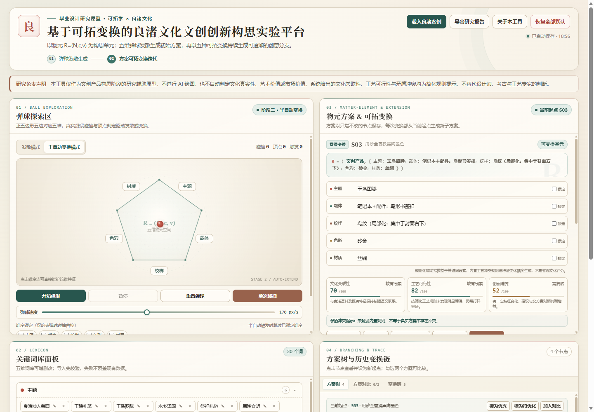

# 基于可拓变换的良渚文化文创创新构思实验平台

毕业设计研究原型：以可拓学物元模型 `R=(N,c,v)` 与五种可拓基本变换为核心，辅助良渚文化文创产品在构思阶段进行发散、变换与路径复盘。

> 本工具是研究辅助原型，不是 AI 绘图工具，也不是普通随机关键词生成器。系统输出的文化关联性、工艺可行性、创新跨度与矛盾冲突提示均为**规则化辅助提示**，不代表客观文化、艺术或市场评价。



## 在线演示

https://leena-free.github.io/liangzhu-extension-prototype/

仓库地址：

https://github.com/leena-free/liangzhu-extension-prototype

也可以直接下载 `index.html`，双击在浏览器中运行。

## 核心功能

- **五维物元拆解**：主题、载体、纹样、色彩、材质。
- **阶段一 · 弹球发散**：Canvas 正五边形真实线段碰撞，撞边采样关键词，集齐五维生成初始物元 `R0`。
- **阶段二 · 可拓变换**：
  - 置换变换
  - 增加变换
  - 删除 / 弱化 / 简化变换
  - 扩缩变换
  - 组合变换（维度融合 / 完整方案融合）
- **半自动路径**：撞边触发置换，撞顶点触发组合，内部飞行随机触发增加、删除、扩缩。
- **方案树与变换链**：每次变换生成全新子节点，保留父节点、旧值、新值、变换目的、理由与约束处理。
- **研究辅助**：方案标记、双方案对比、完整变换日志、Markdown 研究报告导出。
- **数据管理**：localStorage 持久化；关键词库与全量数据 JSON 导入导出；错误 JSON 校验。
- **预置内容**：良渚默认关键词库 + 3 套研究案例。
- **响应式界面**：桌面四区布局，移动端垂直堆叠。

## 技术实现

- 单个 `index.html`，内嵌 CSS 与原生 JavaScript。
- 无前端框架、无构建步骤、无外部 CDN 依赖。
- Canvas 实现正五边形真实线段碰撞检测、法线反弹与顶点判定。
- localStorage 保存关键词库、方案树、变换链、警告决策与界面设置。
- CSS 采用良渚文化气质的玉石青、陶土褐、黑陶墨色与浅玉米白配色。

## 本地运行

直接双击打开：

```text
index.html
```

无需安装依赖或启动服务器。

## 研究边界

- 评价指数由关键词线索、内置工艺冲突规则与特征变化幅度生成，不是可拓关联函数的客观计算结果。
- 方案的文化真实性、艺术价值、市场价值需要设计师、考古研究者与工艺专家进一步验证。
- 当前版本为单机、单人研究原型，尚未接入专家权重、用户实验、多人协作与云端版本管理。
- 厚度、成本等数值特征及经典域/节域演示入口属于后续可选扩展。

## 目录结构

```text
.
├── index.html
├── assets/
│   └── desktop-preview.png
└── README.md
```